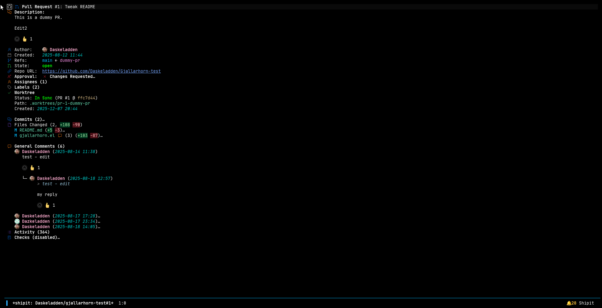
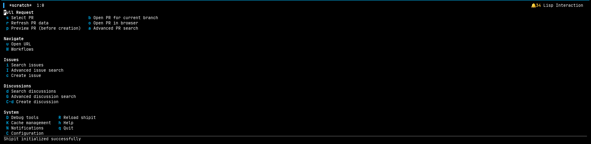
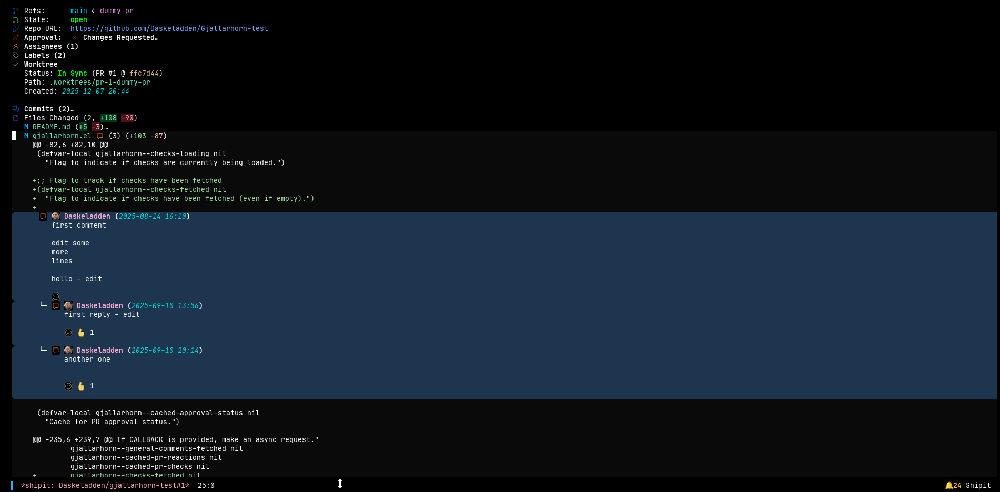
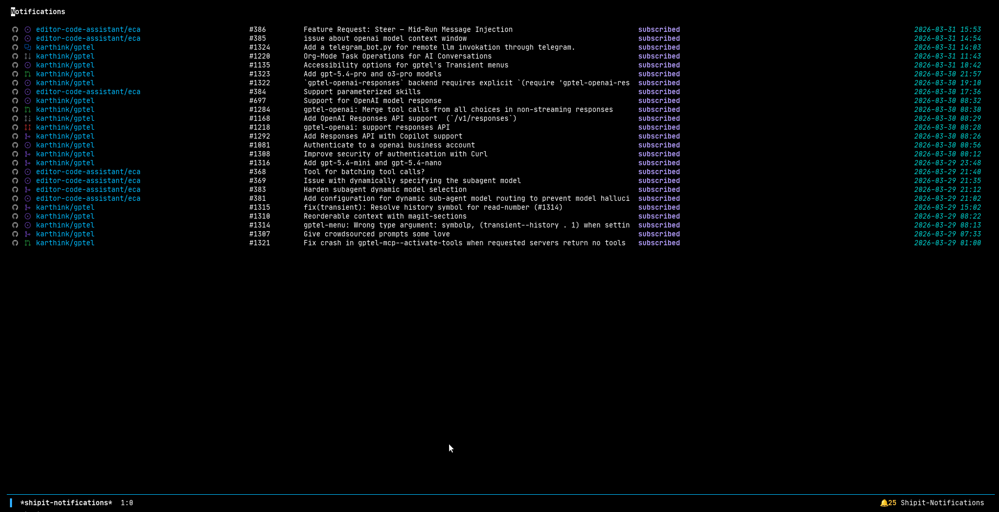
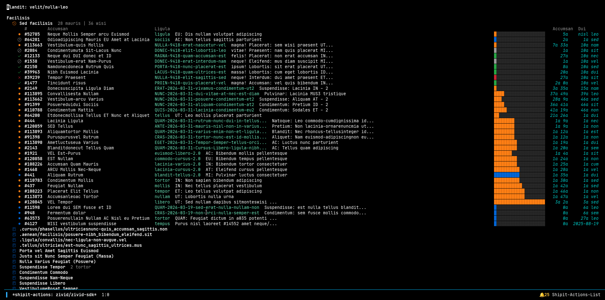

# Shipit

Code review in Emacs. View pull requests, post comments, track CI, and manage notifications without leaving your editor.



This project was built as a learning exercise in agentic AI-assisted programming using [Claude Code](https://claude.ai/claude-code).

**GitHub** is the primary backend with full feature support. **GitLab** and **Jira** backends are available but considered experimental.

## What it does

- **Pull requests** — view description, commits, file changes, labels, assignees, reviewers
- **Linked tracker issues** — PRs show an expandable Issue section auto-detected from the branch name (e.g. `PRJ-12624-foo` → `PRJ-12624`); transient actions for search/link, open, browse, transition status, and create-and-link
- **Comments** — inline diff comments with threading, general comments, reactions, live markdown preview
- **Reviews** — submit approvals, request changes, resolve conversations
- **CI/Checks** — expand check suites to see step logs with timestamp gap coloring
- **Notifications** — poll for updates, see activity that triggered each notification, `RET` jumps into the PR at the exact comment/commit/review, mark as read, subscribe to individual threads
- **Issues** — search, create, and view issues with pinned comments, comment pagination, filtering, and status transitions
- **Atlassian dashboard** — dedicated Jira project buffer (`M-x shipit-atlassian-dashboard`) with My Open Issues, Kanban Board, filterable/loadable all-issues section, and a create-issue action
- **Discussions** — view and participate in GitHub Discussions
- **Subscriptions** — manage repo-level and per-thread subscriptions via transient menu
- **Worktrees** — checkout PR branches into isolated worktrees

Supports SVG icons, inline images, avatars, and syntax-highlighted code blocks.

## Install

Emacs 29.1+, [magit](https://magit.vc/), [transient](https://github.com/magit/transient).

Shipit builds on magit-section for all buffer rendering and navigation, and transient for menus and actions.

```elisp
;; straight.el
(use-package shipit
  :straight (:host github :repo "Daskeladden/shipit" :files ("lisp/*.el"))
  :after magit
  :config
  (shipit-init))

;; elpaca
(use-package shipit
  :elpaca (:host github :repo "Daskeladden/shipit" :files ("lisp/*.el"))
  :after magit
  :config
  (shipit-init))

;; manual
(add-to-list 'load-path "/path/to/shipit/lisp")
(require 'shipit)
(shipit-init)
```

### Canvas views

Three views draw on a canvas image, an image whose pixels Lisp can write. They are the kanban board of the Atlassian dashboard, the job timeline of an Actions run, and the stack canvas of a stacked preview. Canvas images come with Emacs 32. Emacs 32 is not released, so you build it from the master branch, with canvas images and modules. The views also need these packages:

- [canvas-diagram](https://github.com/Daskeladden/canvas-diagram) draws the kanban board and the run timeline. Its `canvas-cairo` module does the drawing for all three views. You compile the module against cairo and pango.
- [canvas-graph](https://github.com/Daskeladden/canvas-graph) lays out the stack canvas.
- [canvas-keys](https://github.com/Daskeladden/canvas-keys) holds the keys of canvas buffers. canvas-diagram requires it.

[canvas-browser](https://github.com/Daskeladden/canvas-browser) plays the videos of issues and pull requests in the buffer, under their Play button. The option `shipit-video-inline-function` names the function that does this, `canvas-browser-embed` by default.

These packages are optional, and shipit does not require them. Without them, a canvas view says what it needs, a video plays outside the buffer, and the rest of shipit works as before.

## Authentication

Shipit uses Emacs auth-source for credentials. Add entries to `~/.authinfo.gpg` (or `~/.authinfo`):

```
# GitHub
machine api.github.com login your-username password ghp_...

# GitLab
machine gitlab.com login your-username password glpat-...

# Jira
machine your-instance.atlassian.net login your@email.com password your-api-token
```

GitHub tokens need `repo` scope. You can also set `shipit-github-token` directly.

For GitLab and Jira, configure backends in your init file.

**Global Jira backend** (applies to every repo that lacks a more specific
mapping):

```elisp
(setq shipit-issue-backend 'jira)
(setq shipit-issue-backend-config
      '(:base-url "https://your-instance.atlassian.net"
        :project-keys ("PROJ")))
```

Credentials for `your-instance.atlassian.net` are picked up from
auth-source (see the `~/.authinfo.gpg` entry earlier in this section).

**Per-repo mapping** via `shipit-issue-repo-backends` — a list of
`(REPO-PATTERN . CONFIG-PLIST)` where REPO-PATTERN is an exact match or
regexp against `owner/name`:

```elisp
(setq shipit-issue-repo-backends
      '(("myorg/backend"
         :backend jira
         :base-url "https://myorg.atlassian.net"
         :project-keys ("BACK"))
        ("myorg/frontend"
         :backend jira
         :base-url "https://myorg.atlassian.net"
         :project-keys ("FE"))
        ("myorg/.*"
         :backend jira
         :base-url "https://myorg.atlassian.net"
         :project-keys ("MYORG"))))
```

Repos not matching any entry fall back to `shipit-issue-backend`.  The
Atlassian dashboard (`M-x shipit-atlassian-dashboard`) refuses to open
when the resolved backend isn't Jira — if you see that error, add a
matching entry to `shipit-issue-repo-backends`.

Per-repo configuration via `.dir-locals.el` is also supported; set
`shipit-issue-backend` and `shipit-issue-backend-config` as buffer-local
directory variables.

## Usage

Run `M-x shipit` from any git repo with a remote.

Navigate with `TAB` to expand/collapse, `RET` to open, and `M-;` for context actions.

### Issue buffers

| Key | Action |
|-----|--------|
| `f` | Filter comments (author, date, text, reactions, bots) |
| `l` | Jump to Load more and open transient menu |
| `w` | Manage repo/thread subscriptions |
| `n`/`p` | Navigate between sections |

Issues with many comments show the first and last few with a "Load more" section in between. Press `l` to open the load-more transient:

| Key | Action |
|-----|--------|
| `RET` | Load next batch |
| `a` | Load all comments |
| `n` | Load N comments |
| `r` | Toggle direction (recent-first / oldest-first) |

Pinned comments appear prominently between the description and comment sections with a rounded background and truncated preview.

The mode line shows your position when navigating comments: `[42/315 ####------]`

In the Activity section, an event that changed the description of a Jira issue opens with `TAB` to a word diff of the change: removed words are struck through in red, and added words are green. The Activity section of a GitHub pull request shows each edit of its description the same way. shipit asks GitHub for the edits along with the timeline, and runs the diff only when you open an edit.

A force push in the Activity section opens to its commits, the old ones paired with the new ones by `git range-diff` and counted as added, on base, dropped, changed or unchanged. A commit on base is one the push dropped because the base branch holds its change already, such as a merged commit of a stack. `TAB` on an added, dropped or on-base commit lists its files, each opening to its diff. On a changed commit it shows a word diff of its message, when that changed, and the files where its change differs. For those, shipit applies the old version of the commit onto the parent of the new one with `git merge-tree` (git 2.40 or newer) and compares the result with the new one, so the diff holds only how this commit changed, and nothing a rebase brought in. When the old version conflicts there, the diff goes from git's conflict markers to the author's resolution. A line says when the push also rebased the branch. When the base branch is unknown, the push opens to the files that differ between its two heads.

### Atlassian dashboard

`M-x shipit-atlassian-dashboard` opens a Jira-focused buffer with My Open Issues, What's Next, an optional Kanban Board, Frequently Visited, and a full filterable Issues section. `f` opens the filter transient (status, assignee, reporter, type, priority, text/comment search, sort), `l` loads more, `M-;` opens context actions including Create new issue with full Jira fields (issue type, components, labels, assignee).

The dashboard requires the current repo to resolve to a Jira backend. Set up the mapping via `shipit-issue-repo-backends` as shown in the Authentication section, or see the [Backend Configuration wiki page](https://github.com/Daskeladden/shipit/wiki/Backend-Configuration).

### Notifications from other packages

Another package can put a notification among those of shipit. It then stands in the notifications buffer and in the count of the mode line. `RET` opens it, which also marks it as read.

```elisp
(require 'shipit-notifications-external)
(shipit-notifications-push
 :source "mail.example"                 ; stands where the repository stands
 :title "New mail"
 :body "From alice"                     ; shown when the notification is unfolded
 :open (lambda () (my-show-the-mail)))  ; or :url, an address for a browser
```

A notification can say why it came, with `:reason` and a word as GitHub uses for its own. With `:reason "mention"` it is counted as a mention: at the `@` of the mode line and in the view of the mentions only.

### Explore

`M-x shipit-explore`, or `e` in the menu of shipit, shows what the people you follow and the repositories you watch do on GitHub: someone starred, forked or created a repository, a release came out, or a repository went public. Each has a line, the newest first, in the columns of the notifications buffer: the repository, who did what, the kind and the time. The lines that you have not seen before stand out. `RET` opens the page of the repository in shipit, or its releases at the tag for a release, `g` reads the feed again, and `L` switches the times between a date and how long ago.

`SPC` or `f` opens a menu of what is shown, and `SPC` closes it again. With meow, Explore and the notifications buffer start in the insert state, because meow takes `SPC` in its motion state. The menu has a switch for each kind of entry. It also chooses whose repositories the entries are about: all repositories, only yours, or only those of others. With only yours, you see who starred or forked your work, and not what the people you follow star elsewhere.

An entry of the feed is no notification of its own, because nothing waits for you there and GitHub keeps no read state for it. shipit can tell you of new entries with one notification instead:

```elisp
(setq shipit-explore-notify t)
```

The feed is then asked for each time shipit polls for notifications. The notification says how many entries are new, opens Explore with `RET`, and can be marked as read as any other. It comes back only when a newer entry arrives.

A switch of the menu stays for the session. `shipit-explore-kinds` and `shipit-explore-about` hold the same choices for your configuration. GitHub hands an event out some minutes to some hours after it happened. It keeps the last 300 events of all that you can see, which the work in a busy repository fills in some hours, and the last 300 public events, which reach back some weeks. Explore reads both. It has no API for the repositories that it calls trending, so those are not in Explore.

## Configuration

```elisp
(setq shipit-use-svglib-icons t)              ; SVG icons (needs svg-lib)
(setq shipit-show-avatars t)                   ; show user avatars
(setq shipit-round-avatars t)                  ; round avatar images
(setq shipit-notifications-enabled t)          ; poll for notifications
(setq shipit-notifications-poll-frequency 300) ; poll interval (seconds)
(setq shipit-render-markdown t)                ; render markdown in descriptions

;; Issue comment pagination
(setq shipit-comments-pagination-threshold 30)  ; paginate above N comments
(setq shipit-comments-initial-count 10)         ; head comments shown
(setq shipit-comments-tail-count 10)            ; tail comments shown
(setq shipit-comments-load-more-default 50)     ; default batch size

;; Pinned comment appearance
(setq shipit-pinned-comment-bg-color "#1a2744") ; rounded bg color (nil to disable)
(setq shipit-pinned-comment-preview-lines 4)    ; lines shown before "View full"
```

## Troubleshooting

`M-x shipit-doctor` checks your token, API access, and rate limits.

`M-x shipit-toggle-debug-logging` enables debug logging to `~/.emacs.d/shipit-debug.log`. Note: debug logging slows down PR loading — disable it when not actively debugging.

## Screenshots

**Main menu (`M-x shipit`)**



**Inline comments with threaded replies**



**Notifications**



**GitHub Actions — workflow runs with elapsed time bars**



## License

GPL-3.0-or-later
